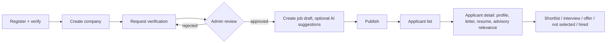

# User flows

## Candidate: first application

```mermaid
flowchart LR
  A[Register + AI consent choice] --> B[Verify email]
  B --> C[Sign in]
  C --> D[Upload resume]
  D --> E{Processing}
  E -->|completed| F[Review facts: accept / reject]
  E -->|failed| D2[See reason, retry or upload another]
  F --> G[Edit profile + preferences]
  G --> H[Recommendations]
  H --> I[Job detail + match explanation]
  I --> J[Prepare application]
  J --> K[Draft or write cover letter; review flagged claims]
  K --> L[Tick confirmation, then confirm dialog]
  L --> M[Application detail: Submitted]
  M --> N[Notification when the employer updates status]
```

## Employer: hire

## Admin

Verification queue → approve/reject with signals; reports → dismiss/pause/close; users → suspend/reinstate;
failed tasks → retry; audit log search.
