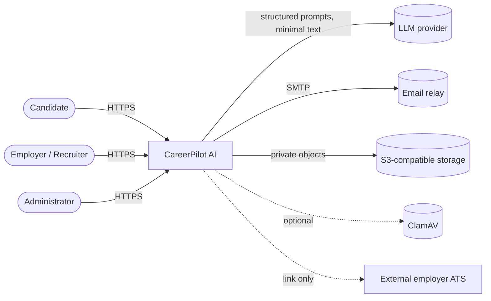
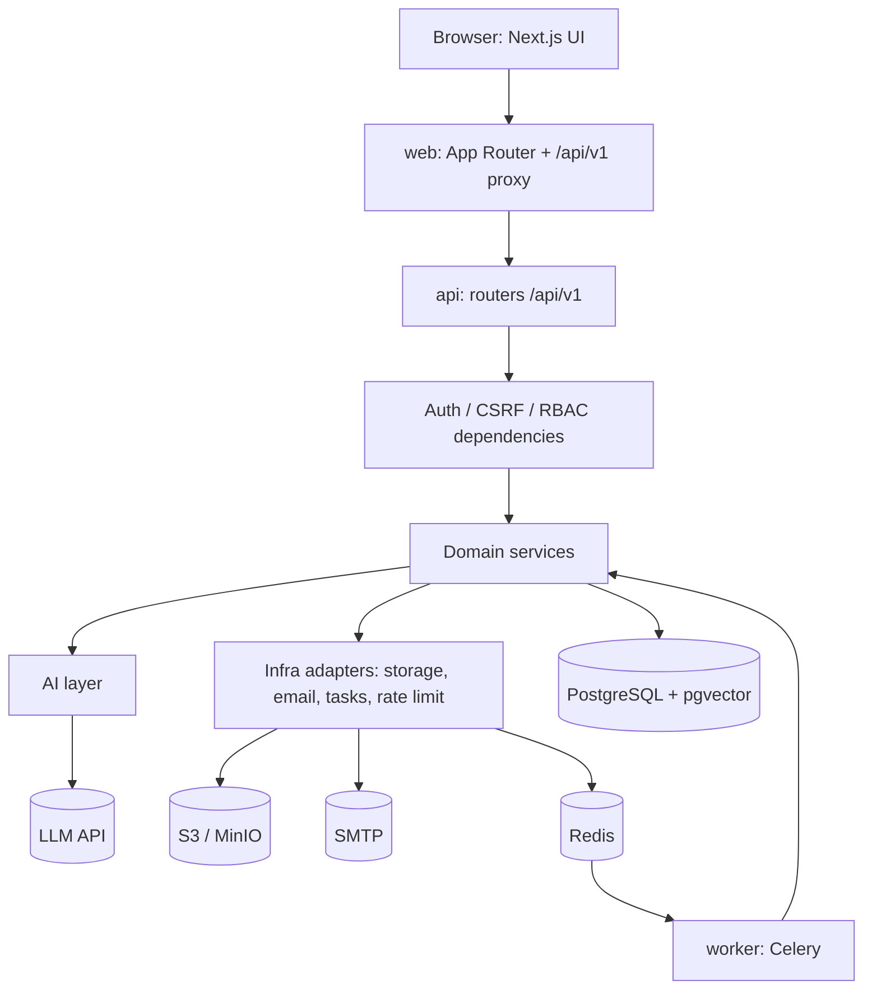
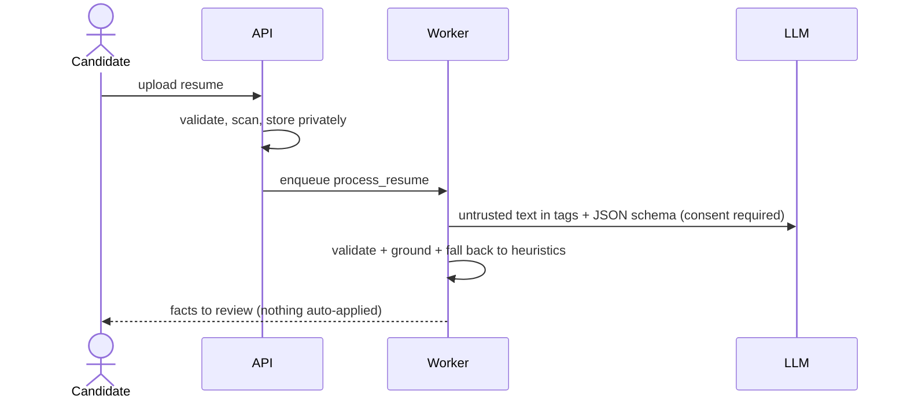

# Architecture

CareerPilot AI is a **modular monolith**: one FastAPI codebase (`services/api/careerpilot`) serves the HTTP
API and runs background work through a separately deployed Celery worker. A Next.js app (`apps/web`) provides
the UI and proxies `/api/v1/*` to the API, so session cookies stay first-party. See
[ADR 0001](adr/0001-modular-monolith.md).

Editable diagram sources live in [`docs/diagrams/`](diagrams/). They are embedded below so GitHub renders them.
No SVG/PNG renders are committed yet: no Mermaid CLI was available when they were authored (see
[KNOWN_LIMITATIONS.md](KNOWN_LIMITATIONS.md)).

## System context

## Containers and modules

| Layer | Path | Responsibility |
| --- | --- | --- |
| Routers | `careerpilot/api/routes/*.py` | HTTP contracts, input DTOs (`api/schemas.py`), response mapping (`api/serializers.py`) |
| Dependencies | `careerpilot/api/deps.py` | Session resolution, CSRF + Origin checks, role gates |
| Domain services | `careerpilot/services/*.py` | Business rules, state machines, transactions, ownership/tenant checks |
| AI layer | `careerpilot/ai/*.py` | Provider interfaces, versioned schemas and prompts, taxonomy, heuristics, guarded client |
| Infra | `careerpilot/infra/*.py` | Storage, email, background-task dispatch |
| Security primitives | `careerpilot/security/*.py` | Password hashing, tokens, rate limiting, URL/SSRF guards |
| Models | `careerpilot/models/*.py` | SQLAlchemy 2 models; migrations in `alembic/versions` |

### Domain module map (spec section 4)

| Module | Status | Location |
| --- | --- | --- |
| Authentication and identity | Implemented | `services/auth.py`, `api/routes/auth.py` |
| Profiles and preferences | Implemented | `services/profiles.py`, `api/routes/candidate.py` |
| Email and verification | Implemented | `infra/email.py`, `services/auth.py` |
| Companies and employer verification | Implemented (single-owner; invitations planned) | `services/companies.py` |
| Job publishing | Implemented | `services/jobs.py` |
| Resume and document processing | Implemented (OCR optional) | `services/documents.py`, `services/resumes.py` |
| AI extraction and normalization | Implemented | `ai/` |
| Skills taxonomy | Implemented | `ai/taxonomy_data.py`, `skills_taxonomy` table, admin API |
| Matching, search, ranking | Implemented (rules-v1) | `services/matching.py`, `services/jobs.py` |
| Cover letters | Implemented | `services/generation.py` |
| Resume customization | Planned (table exists) | `resume_versions` |
| Applications + tracking + notifications | Implemented | `services/applications.py`, `services/notifications.py` |
| Interview scheduling | Implemented (basic) | `services/applications.py` |
| Interview preparation, career guidance | Planned | — |
| Employer applicant management | Implemented | `api/routes/employer.py` |
| Admin moderation and auditing | Implemented | `api/routes/admin.py`, `services/audit.py` |
| Billing readiness | Planned | — |
| Analytics and AI evaluation | Partial (usage records, metrics endpoint, offline harness planned) | `ai/client.py` |
| Privacy, consent, deletion | Implemented | `services/privacy.py`, `services/consent.py` |
| Background jobs | Implemented | `infra/tasks.py`, `worker.py` |

## Key flows

- Authentication and verification: [auth-verification.mmd](diagrams/auth-verification.mmd)
- Resume ingestion: [resume-ingestion.mmd](diagrams/resume-ingestion.mmd)
- Job publishing: [job-publishing.mmd](diagrams/job-publishing.mmd)
- Matching and ranking: [matching.mmd](diagrams/matching.mmd)
- Application submission: [application-submission.mmd](diagrams/application-submission.mmd)
- Deployment: [deployment.mmd](diagrams/deployment.mmd)
- ER diagram: [er-diagram.mmd](diagrams/er-diagram.mmd) and [DATA_MODEL.md](DATA_MODEL.md)

## Cross-cutting decisions

- **Sessions, not JWTs.** Opaque random session tokens in HttpOnly cookies; only SHA-256 hashes are stored, so
  sessions are revocable (logout, password change, admin suspension). See [ADR 0003](adr/0003-session-auth.md).
- **Tenant isolation in services.** Every company-scoped read/write passes `companies.require_member()`, which
  returns 404 for non-members (no existence oracle). Candidate resources are filtered by owner id.
- **State machines in code.** Job and application transitions are explicit tables
  (`services/jobs.TRANSITIONS`, `services/applications.EMPLOYER_TRANSITIONS`); invalid transitions return 409.
- **AI never authorizes.** Model output can only populate suggestions (facts, drafts, parsed requirements).
  Scores, eligibility and permissions are deterministic code. See [AI_ARCHITECTURE.md](AI_ARCHITECTURE.md).
- **Graceful degradation.** Without AI: heuristic extraction, manual cover letters, and SQL job search all work.
  Without Redis: in-process rate limiting and inline tasks (development only).
- **Portability for tests.** PostgreSQL is the production database; the test suite can also run on SQLite via a
  `Vector` type decorator that falls back to JSON and an in-Python cosine. CI runs both.
